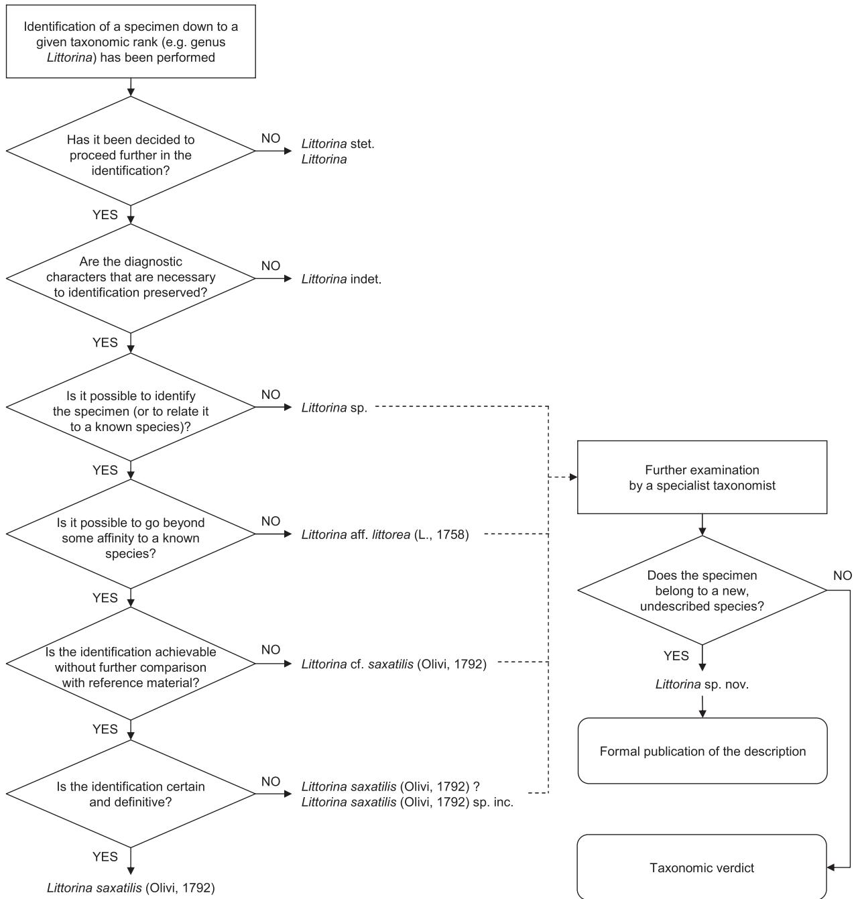

#  REVIEW 

##  Open Nomenclature in the biodiversity era 
 Marco Sigovini  1*  , Erica Keppel  1,2  and Davide Tagliapietra  1 
 1  CNR – National Research Council of Italy, ISMAR – Marine Sciences Institute, Arsenale Tesa 104, Castello 2737/F, I-30122 Venice, Italy; and  2  Smithsonian Environmental Research Center (SERC), 647, Contees Wharf Road, Edgewater, MD 21037, USA 

###  Summary 

-  1. The uncertainty or the provisional status of a taxonomic identification can be expressed by a set of terms and abbreviations known as Open Nomenclature (ON) qualifiers. This approach is widely applied across biological disciplines, and a high amount of biodiversity data left in ON can be found in literature and data bases. However, there is no consensus about ON qualifiers and their meaning. 
-  2. The use of ON qualifiers has been reviewed in order to provide a summary and guide to current practice in zoology. Some recommendation is given to avoid inconsistencies or vagueness. A flow chart is proposed to clarify the sources of uncertainties during identification and to facilitate the application of ON qualifiers. 
-  3. This review provides a guide for taxonomists and ecologists currently involved in biomonitoring and biodiversity programmes, as well as for researchers dealing with biodiversity data infrastructures and tools, offering a starting point for a methodological harmonization. 
**Key-words:** biodiversity informatics, biomonitoring, controlled vocabulary, primary biodiversity data, semantic tools, species/abundance matrices, taxonomic databases, taxonomy, uncertainty, zoology 

###  Introduction 

 An increasing number of monitoring plans requires taxonomic identification for the purposes of both biodiversity and environmental quality assessment. A decade ago, the European Water Framework Directory (2000/60/EC) and, more recently, the European Marine Strategy Framework Directive (2008/56/EC) established the requirements for the ecological quality of the European waters. In this framework, the quality assessment of water systems is largely based on their biodiversity and community structure. Other large programmes all over the world, including the National Estuary Program in the USA and the Marine Monitoring Programs in Australia, rely on the monitoring of biological communities. As a consequence, an increasing number of community data are produced, generally in the form of species/abundance (SA) matrices. At the same time, there is a world-wide commitment in building large or even global-scale inventories and in reconstructing time series and biodiversity trends with the recovering and analysis of historical data. Despite the increasing need of taxonomic expertise, how to face the decline in trained taxonomists is still debated (Pearson, Hamilton & Erwin 2011). 

 Species description and identification is still largely based on morphological traits. The taxonomist has the burden to recognize and name each individual of a particular assemblage and to compile SA matrices that will be finally entered in data bases 

 for subsequent elaboration. Sometimes the identity of a specimen is uncertain since it cannot be exactly, definitely or readily determined. This uncertainty may derive from various causes, including bad state of preservation or incompleteness of the specimen, variability of diagnostic characters, not envisaged morphotypes or different taxonomic perspectives which translates into identification resources. Moreover, it can be related to the lack of the species in the identification keys, in which case the specimen may belong to a non-indigenous species or a species unknown to science. In all these cases, scientists may express the uncertainty or the provisional status of the identification using a procedure called ‘Open Nomenclature’ (ON) (Richter 1948; Matthews 1973; Bengtson 1988). The approach is based on an ensemble of terms and their abbreviations (called ‘signs’), which can be combined to taxon names. Terms and signs are also called ‘qualifiers’. Taxa are said to be ‘left in open nomenclature’ to underline that the identification is not yet fully accomplished (Matthews 1973). ON qualifiers may express different kinds and degrees of uncertainty. 

 The approach is widely applied across taxonomic disciplines, including both production and research taxonomy (Stribling, Moulton & Lester 2003). However, nomenclature and notations from different biological branches such as botany and microbiology diverged since their origin in both formal and substantive aspects (Minelli 2008). This paper is focused on the use of ON in zoological disciplines. 

 The procedure was developed primarily in palaeontology, essentially because of the fragmentary nature of fossils. Despite the need for a uniform approach is felt for a long time (e.g. 

 *Correspondence author. E-mail: marco.sigovini@ve.ismar.cnr.it 

 Richter 1948), ON is not regulated by standards or guidelines. The International Code of Zoological Nomenclature (ICZN 1999) does not deal with ON qualifiers, since they do not form part of the name of a taxon (Art. 5.3). The literature discussing the subject is inconsistent and limited to a handful of papers predating the age of digital information (e.g. Matthews 1973; Bengtson 1988). Some general indications are presented in textbooks on taxonomic procedures (e.g. Schenk & McMasters 1936; Winston 1999). Nevertheless, the application of ON terms still retains ambiguity: when taxonomists or ecologists produce or consult taxonomic lists, the meaning they attribute to the qualifiers depends on the branch of biology, the laboratory traditions and their own experience (Chapman 2005). 

 The harmonization of ON practice would benefit people involved at each step of biodiversity data life cycle: taxonomists working on identifications, but also biodiversity informaticians, ecologists and other data users who were not involved in the production of the data. A consistent and shared ON vocabulary would help with the design, implementation and maintenance of biodiversity data infrastructures and tools. 

###  Annotated list of Open Nomenclature qualifiers 

 The main ON terms and abbreviations found in the literature, and other data resources have been collected and discussed, in order to provide a summary and guide to current practice in zoology. Latin terms are italicized. All the examples are drawn from aquatic extant fauna. Some qualifiers are also used in other biological disciplines with the same or similar meaning. Some advices are given to regulate the use of those terms which are currently vaguely or inconsistently applied. To facilitate the application of ON qualifiers, a flow chart is proposed (Fig. 1), which also summarizes the main sources of uncertainties arising during the identification. Current use of the ON syntax is more consistent. The placement of the qualifiers with respect to the taxon name follows Matthews (1973) and Bengtson (1988). When attached to names, signs should not be spelled in italics, which is reserved for genus and species names. If the author (and date) follows the taxon name, no qualifier should be inserted between them (Matthews 1973). The combination of a taxon name and a qualifier may be found multiple times in the literature, describing just as many different taxa. Therefore, provisional designations should be followed by a unique identifier, such as a reference to the author and year. A reference to voucher specimens (typically between parentheses) may also be used (Chapman 2005). 

 Other main qualifiers frequently used in taxonomic records and closely associated with ON practice are presented in a subsequent section. They include qualifiers expressing unresolved taxonomic status or different taxon views. They also include qualifiers describing the life stages or morphotypes; they may account for the achieved level of taxonomic resolution, at the same time conveying additional information. 

 All the qualifiers and definitions are summarized in alphabetical order in Appendix S1 (Supporting Information). 

**species** , abbreviation: **sp.** (e.g. _Nucula_ sp.). 

 This qualifier is used after the generic name when the specimen has not been identified down to the species level, nor it has been related to any known species. In the literature, this impasse has been attributed to different causes (e.g. Matthews 1973). According to the most common usage, the uncertainty is potentially provisional; for instance, it could be due to the lack of suitable dichotomous keys for the description of a particular morphotype. Otherwise, it could be a species not yet described. Therefore, specimens qualified with 'sp.' require careful consideration since they could belong to non-indigenous or previously undescribed species. 

 The qualifier has also been used when a specimen is indeterminable due to the deterioration or lack of diagnostic characters, or when the identification has not been attempted despite it could have been possible (Bengtson 1988). Since it may be useful to distinguish among these sources of uncertainty, in these cases we recommend to use the qualifiers _species indeterminabilis_ and _stetit_ , respectively (see below). 

 If distinct species are recognized within the same genus, but it is not possible to assign a name to any of them, the qualifier should be followed by a sequential identifier, for instance 'sp. 1', 'sp. 2', etc. or 'sp. A', 'sp. B', etc. 

**species** in the plural form, abbreviation: **spp.** , or **species plurimae** , abbreviation: **sp. pl.** (e.g. _Unio_ spp.). 

 This qualifier is used to describe the presence of more than one species of the same genus, whose identification was not achieved. This qualifier should be avoided in SA matrices, since, when integer specimens are analysed, it should be possible to separate them into different provisional species ('sp. 1', 'sp. 2', etc.). Conversely, in case diagnostic characters are missing, the qualifier _species indeterminabilis_ should be preferred. 

**genus species** , abbreviation: **gen. sp.** or **g. sp.** (e.g. Zoarcidae gen. sp.). 

 This qualifier is used when the specimen has not been identified neither at the species nor at the genus level. It has the same meaning of 'sp.' but at a higher taxonomic rank. The qualifier generally follows the name of the family. The qualifier may also be abbreviated unambiguously to the lowest rank, that is 'sp.' (e.g. Zoarcidae sp.). 

**familia genus species** , abbreviation: **fam. gen. sp.** (e.g. Nematoda fam. gen. sp.). 

 This qualifier has the same meaning of 'sp.' but it is used when the uncertainty refers to the family level. The qualifier may also be abbreviated unambiguously to the lowest rank, that is 'sp.' (e.g. Nematoda sp.). 

**subspecies** , abbreviation: **ssp.** or **subsp.** (e.g. _Salmo trutta_ Linnaeus, 1758 ssp.). 

**Fig. 1.** Flow chart for using main Open Nomenclature qualifiers. The degree of confidence essentially increases from the top down. 

 Subspecies is the only rank below the species level accepted by the ICZN (1999). As ON qualifier, it has the same meaning of ‘sp.’ when the uncertainty refers to the subspecific level. 

_species indeterminabilis_ = indeterminable species (or _species indeterminata_ = not determined species), abbreviation: **indet.** , **ind.** , **sp. indet.** or **sp. ind.** (e.g. _Lekanesphaera_ indet.). 

 The abbreviation ‘indet.’ and similar forms have been associated from time to time to two slightly different terms: _species indeterminata_ , that is ‘indeterminate, not determined species’, and _species indeterminabilis_ , that is 

 ‘species that cannot be determined’. The latter meaning is usually associated with the poor condition or incompleteness of the specimen. Some authors have used the two meanings interchangeably (e.g. Hawksworth 2010). Occasionally, both these forms have been also used as synonym of ‘sp.’ (e.g. Matthews 1973). We propose the sign ‘indet.’ to be used as an abbreviation of _indeterminabilis_ (as in Matthews 1973) and to indicate that the specimen is indeterminable beyond a certain taxonomic level due to the deterioration or lack of diagnostic characters, especially in the case of damaged material and missing parts (see, e.g. Granzow 2000). This qualifier 

 can be also used at higher taxonomic ranks (e.g. Clavulariidae indet.). 

**species nova** or **nova species** = new species, abbreviation: **sp. nov.** , **spec. nov.** , **sp. n.** , **nov. sp.** , **nov. spec.** or **n. sp.** (e.g. _Tisbe_ sp. nov.). 

 The specimen is considered to belong to a new, previously undescribed, species. The form ‘sp. nov.’, in which the adjective is placed after the noun, is the most common. Similar terms are also applied to the subspecies ( **subspecies nova** , abbreviated **ssp. nov.** , **subsp. nov.** , **ssp. n.** , **subsp. n.** , **n. ssp.** , etc.), genus ( **genus novum** , abbreviated **gen. nov.** , **g. nov.** , **gen. n.** , **g. n.** , **nov. gen.** , **n. g.** , etc.; also in combination with species: **gen. et sp. nov.** , **nov. gen et sp.** , etc.) and familia level ( **familia nova** , abbreviated **fam. nov.** , **fam. n.** , **nov. fam.** or **n. fam.** ). These qualifiers are used in two different circumstances. On the one hand, the International Code of Zoological Nomenclature requires the use of these qualifiers (or some strictly equivalent expression) to explicitly indicate taxa names as intentionally new (ICZN 1999: Art. 16.1 and Recommendation 16A). When describing a new species, the publication ( _sensu_ ICZN 1999) of a binomen followed by an abbreviation such as ‘sp. nov.’ or ‘n. sp.’ (or a similar expression) constitutes a nomenclatural act (e.g. _Pelagia benovici_ sp. nov. in Piraino _et al._ 2014). The role of these qualifiers in nomenclatural texts is discussed in more detail by Cambefort (2015). 

 On the other hand, they are commonly found in literature as ON qualifiers, as a way to refer to new, still unnamed taxa before the formal publication of the description (Matthews 1973; Bengtson 1988). In this case, the qualifier is attached to a higher-rank taxon: for instance, the abbreviation ‘sp. nov.’ follows the genus name (and is sometimes followed by a sequential identifier; e.g. _Pristiophorus_ sp. nov. A). This usage does not imply a nomenclatural act and is therefore not inconsistent with the ICZN (1999). However, any ambiguity can be avoided by applying a broader ON qualifier such as ‘sp.’ (e.g. _Pristiophorus_ sp. A). 

**affinis** , abbreviation: **aff.** ; or **species affinis** , abbreviation: **sp. aff.** = affinity with a known species, from the Latin for ‘has affinity with’ (e.g. _Pourtalesia_ aff. _alcocki_ Koehler, 1914); it is not required to repeat the genus after the qualifier neither in full or abbreviated form (Zidek 1987; Bengtson 1988). 

 This qualifier indicates that the specimen has some affinity to a known species but it is not identical to it. The specimen differs clearly from the species description, but it may fall within the variability limits of the species. Otherwise, it can be possibly attributed to a species with strong affinity with a known one, in terms of phylogenetic relatedness. Possibly, it may belong to a new, undescribed species (Bengtson 1988). According to Lucas (1986) and Bengtson (1988), the qualifier implies distinction more than a possible identity, in contrast to the meaning usually given to the term _confer_ (see below). However, other taxonomists regard them as synonymous (Zidek 1987), or consider _affinis_ to indicate a 

 greater degree of confidence (Estes 1987). The qualifier is also found in literature in the form _ex affinis_ , abbreviated **ex aff.** (e.g. Schenk & McMasters 1936); however, this is a Latin misconstruction. 

 Similar qualifiers have been used in more limited contexts, such as in entomology. These include **species proxima** (‘the nearest species’, abbreviated **prox.** or **sp. prox.** ) and **species near** (abbreviated **nr.** or **sp. nr.** ), which indicate that the specimen is near but not identical to a known species, implying that it may belong to a new one. The term _ex grege_ (‘of the group including’, abbreviated **ex gr.** or **gr.** , from the Latin _grex_ : herd, group; the form _ex grupo_ , reported e.g. in Schenk & McMasters 1936, is false etymology since the word _grupo_ does not exist in Latin) is also generally intended to indicate affinity, but in a weaker sense than the previous qualifiers, and is frequently applied in some microfaunal groups with important fossil records such as Ostracoda (e.g. _Pseudocandona_ ex gr. _eremita_ ; Vejdovsky, 1882). The differences between these terms are rather subjective. All they have been frequently used when dealing with species complexes and groups (see below). In all these cases, the qualifier is frequently used in combination with _species nova_ (e.g. _Petrolisthes_ sp. nov. aff. _rufescens_ (Heller, 1861); the two qualifiers may also be separated by a comma). 

**confer** , abbreviation: **cf.** , **cfr.** , **conf.** or **sp. cf.** = to compare, or to be compared with, imperative mood from the Latin _confero_ , infinitive _conferre_ : ‘to bring together’ (e.g. _Polycera_ cf. _hedgpethi_ Er. Marcus, 1964); it is not required to repeat the genus after the qualifier neither in full or abbreviated form (Zidek 1987; Bengtson 1988). 

 This qualifier indicates that most of the diagnostic characters correspond to a given species, but some characters are unclear. The identification is provisional but is likely to be definitive after comparing with reference material or consulting a specialist of the taxon. It generally implies a lower degree of uncertainty compared to _affinis_ (Lucas 1986; Bengtson 1988); however, other taxonomists have the opposite view (Estes 1987) or consider them synonymous (Zidek 1987). The term also overlaps in part with the ‘sign of uncertainty’ (see _species incerta_ ), but the latter should indicate a higher reliability in the identification (Richter 1948; Matthews 1973). The abbreviation does not stand for _conformis_ , meaning ‘similar’, ‘of the same shape’, as in Lucas (1986). 

**species incerta** = uncertain species, abbreviation: ‘ **?** ’, **sp. inc.** or **inc.** (e.g. _Tubifex tubifex_ (Müller, 1774) ? = _Tubifex tubifex_ (Müller, 1774) sp. inc.). 

 The question mark (‘sign of uncertainty’, Matthews 1973) is attached to a taxon when the identification has been carried out correctly but, for some reason, is still uncertain and needs further investigation. According to Richter (1948) and Matthews (1973), it should indicate a higher reliability in the identification with respect to _confer_ , while Bengtson (1988) consider them as almost synonyms. 

 In the literature, the placement of the question mark with respect to the taxon name may follow different approaches (Kornicker 1979). Following Matthews (1973) and Bengtson (1988), as well as an example in the ICZN (1999: Art. 11.9.3.4), we suggest to place the sign after the taxonomic level to which it is applied. The question mark can be related to the genus level in a binomen to express uncertainty in the assignment of the species to established genera (Matthews 1973; Bengtson 1988; ICZN 1999: Art. 11.9.3.4), or in the entire assignment (Kornicker 1979). This approach is typically found in palaeontological studies and is generally not applied during conventional taxonomic identifications. 

 The term _species incerta_ (abbreviated as ‘sp. inc.’) is originally unrelated to the question mark. It has been used with different meanings, including as a synonym for ‘sp.’ and ‘indet.’ (as in Matthews 1973), and even for the terms _species inquirenda_ and _species dubia_ , which are not ON qualifiers (see below). The abbreviations **gen. inc.** and **gen. et sp. inc.** are also found. We propose the usage of these qualifiers to be restricted to the meaning of ‘uncertain identification’ and to be equated to the question mark. Since the latter may be considered as a ‘wildcard’ by some software, in data stored in digital form it may be conveniently substituted by ‘sp. inc.’, ‘gen. inc.’, etc. The term _species incerta_ should not be confused with _incertae sedis_ (‘of uncertain taxonomic position’, abbreviated **inc. sed.** ) which means that the taxonomic position is uncertain (ICZN, 1999; see also _species inquirenda_ ). 

**stetit** , abbreviation: **stet.** (or intentional absence of any qualifier) = further identification has not been attempted, from the Latin for ‘he/she stood, stayed, remained’, perfect tense of the verb _sto_ (e.g. Teredinidae **stet.** = Teredinidae). 

 To the best of our knowledge, there is no qualifier in use to clearly state that is not wanted, or found useful, to go further into the identification, even if allowed by the condition of the specimen. We suggest using the term _stetit_ after the taxon name to explicitly express the identifier choice of not proceeding further. The intentional absence of any qualifier should also be given the same meaning. This approach can be also used when aggregating data sets, in case is needed to merge more records with different ON qualifiers into a unique entry at a safe level (e.g. ‘ _Corophium_ sp.’ and ‘ _Corophium_ indet.’ may be merged as ‘ _Corophium_ ’ or ‘ _Corophium_**stet.** ’). 

**animalia cetera** , abbreviation: **a.c.** or **A.C.** = the remaining animals. 

 Under this term are grouped all the unidentified specimens not listed as separate taxa in SA matrices. It bears on scarce descriptive information and is usually employed with summarizing purposes, mainly in technical reports. The term **cetera** (abbreviated **c.** or **cet.** ) may also be applied to high-rank taxa with the same meaning of _stetit_ but explicitly excluding subordinate taxa that may have been identified 

 (e.g. ‘ _Peracarida_ c.’ listed together with ‘ _Amphipoda_ ’ would include all the _Peracarida_ in the sample which are not _Amphipoda_ ). 

###  Other qualifiers 

**forma** , abbreviation: **f.** = form (e.g. _Littorina saxatilis_ f. _elon-gata_ Dautzenberg & P. Fisher, 1912). 

**varietas** , abbreviation: **var.** , **v.** = variety (e.g. _Caretta caretta_ var. _olivacea_ Deraniyagala, 1930). 

_Forma_ and _varietas_ are taxonomic categories below the species level. In botany, their use as infrasubspecific categories is explicitly regulated by the International Code of Nomenclature for algae, fungi and plants (McNeill _et al._ 2012). They are considered infrasubspecific categories also in zoology (with the exception of names published before 1961, in which case they have to be considered subspecific, unless the author expressly gave it infrasubspecific rank; see ICZN 1999: Art. 45.6), but since categories below the level of subspecies are not regulated by the ICZN (1999), they should be more properly regarded as morphological terms (Winston 1999). _Forma_ and _varietas_ are the most common infrasubspecific categories among those introduced in the past; however, they have been used inconsistently and sometimes even interchangeably. 

 In case of polymorphism, the qualifier **morph** (but also **form** ), followed by an identifier, is used. Alternative growth forms or reproductive phenotypes may be recorded by adding specific qualifiers. Aberrant specimens are pointed out by the qualifier **aberratio** ( **ab.** = aberration, aberrant form). Both the qualifiers ‘ **morph** ’ and ‘ **ab.** ’ identify infrasubspecific categories according to the ICZN (1999: Art. 45.6). 

**species complex** , abbreviation: **complex** = from the Latin _complexus_ , form of _complector_ : ‘I entwine, encircle, compass, infold’ (e.g. _Capitella capitata_ (Fabricius, 1780) complex). 

 The species complex is generally understood as a group of related species characterized by unclear boundaries, typically due to phenotypical similarities. It refers to either a group of sibling or cryptic species. The term ‘sibling species’ was coined by Mayr (1940) and defined as ‘morphologically similar or identical populations that are reproductively isolated’ (Mayr 1963), although the term has also been applied to cases of incomplete reproductive isolation. ‘Cryptic species’ literally means ‘hidden species’ (from the Greek κρύπτω: ‘I conceal’) since they cannot be discriminated through classical morphological taxonomy. The difference between the two terms is subtle, since the former put emphasis on genetic relationship and the latter on morphological resemblance (Steyskal 1972; Knowlton 1986). The existence of cryptic species is generally inferred by diverging non-morphological characters in individuals previously thought to belong to the same species (Bickford _et al._ 2007). The number of species complexes has remarkably 

 increased due to molecular studies (Knowlton 2000; Pfenninger & Schwenk 2007). 

 In practice, a species complex is a group of very similar, closely related species still waiting for a critical revision to clarify the taxa involved and the diagnostic traits. In this case, the identification may be left in ON with a reference to the species complex, similarly to the use of the qualifier _stetit_ . Other informal supraspecific categories comparable to species complex are used, including **species aggregate** ( **sp. agg.** or **agg.** ) and **species group** ( **group, sp. gr.** or **gr.** ). 

**species inquirenda** , abbreviation: **sp. inq.** = species to be queried (e.g. _Polycirrus pellucida_ (Quatrefages, 1866) sp. inq.). 

 This qualifier indicates a species of doubtful identity, needing further investigation (ICZN 1999: Glossary). It cannot be considered an ON qualifier, since it is not used to communicate the uncertainty when attributing a specimen to a certain taxon. Instead, it is added by specialist taxonomists to the name of species with unresolved taxonomic status. It can be associated with the term _incertae sedis_ ( **inc. sed.** ), which indicates that the taxonomic position of the taxon is also uncertain (ICZN 1999: Glossary). The similar qualifier _species dubia_ ('doubtful species', abbreviated **sp. dub.** ) is also found in the literature. 

**secundum** , abbreviation: **sec.** = according to, following (e.g. _Sousa chinensis_ (Osbeck, 1765) sec. Jefferson & Rosenbaum 2014). 

**sensu** = in the sense used by (e.g. _Sousa chinensis_ (Osbeck, 1765) _sensu_ Jefferson & Rosenbaum 2014). 

 A view of what constitutes a taxon is known as 'taxon concept'. It relates a taxon name to the taxon 'circumscription' as intended by a particular author (Kennedy, Kukla & Paterson 2005; Franz, Peet & Weakley 2008). Taxonomic concepts may be specified by adding after the name a label composed of the sign 'sec.' and a reference to the authorship. Berendsohn (1995) recommended this approach when introducing the concept of 'potential taxon', equivalent to the taxon concept. Anyway, the term _secundum_ was traditionally used since the early 1800s (Welter-Schultes 2012). The term _sensu_ refers more generally to the usage of a name by an author (ICZN, 1999: Glossary), but it is often used interchangeably with _secundum_ . Qualifiers with a looser meaning such as _sensu lato_ or _sensu amplo_ ( **s.l.** , **s. lat.** , **s.a.** , **s. ampl.** ; 'in the broad sense') and _sensu stricto_ ( **s.s.** , **s. str.** ; 'in the strict sense'), as well as related comparatives and superlatives, are also used when the complete reference to the taxon concept is implied (e.g. _Cliona_ s.l., _Cliona_ s.s.). 

 Taxa at any rank are circumscribed either by a set of diagnostic characters, by listing the set of subordinate taxa (or specimens) which are stated to belong to the taxa or, finally, by asserting the mutually exclusive relationships with other taxa (Kennedy, Kukla & Paterson 2005). Accordingly, the reference can be an identification key, a research article, a monograph or a checklist. Despite taxonomic concepts are 

 not related to ON, they bear fundamental information about the identification process. The taxon concept associated with a name can evolve, or different taxon concepts can simultaneously exist according to different sources or authors views. A typical case comes from the partition of a taxon, which causes the establishment of a new, more circumscribed, taxon concept with the same name and rank, with the simultaneous creation of one or more new taxa with different names. Problems arise when the taxon concept is not explicitly stated nor it can be retraced on the basis of published details. In principle, each taxon reported in a taxonomic list should therefore be associated with an explicit definition of the taxon concept. In practice, this reference is meaningful when there are different circumscriptions of the same taxon. In this case, it may be a good practice to specify the taxon concept, for example by referring to the identification key. 

 The 'taxon concept' arose at first for botanical data bases, but its use in biodiversity informatics is widening (see, e.g. Laurence _et al._ 2014; Lepage, Vaidya & Guralnick 2014; Franz _et al._ 2015). However, this approach is still debated, particularly when applied to zoological data (Welter-Schultes 2012). 

**Life stages** may be indicated by proper qualifiers. They are frequently used in certain areas of research, for instance in the biomonitoring of freshwater ecosystems, where the presence of insects at different life stages can be diagnostic of environmental conditions. Main life stage qualifiers include the following: 

**larva/ae** , abbreviation: **lv.** or **l.** (e.g. _Chironomus salinarius_ Kieffer, 1915 lv.). 

**juvenile/s** , abbreviation: **juv.** (e.g. _Gadus morhua_ Linnaeus, 1758 juv.). 

 Both these qualifiers are used to differentiate life stages with particular ecological significance and to allow a proper interpretation of the abundances, which may be very high but ephemeral. Moreover, both can be used as ON qualifier to account for incomplete identification when diagnostic characters are not fully developed (e.g. _Acartia_ juv.). 

**adultus/i** , abbreviation: **ad.** (e.g. _Parasagitta elegans_ (Verrill, 1873) ad.). 

 The qualifier can be used to differentiate life stages with particular ecological significance. If not strictly necessary, it can be dropped to avoid redundancy. 

 For certain taxonomic groups, particular life stages, such as **pupa/ae** ( **p.** ) in holometabolous insects, may be recorded. Sometimes other qualifiers related to life history are used, such as the presence of ovigerous females (generally abbreviated **ov.** , **ovig.** ). The sex of the individuals is also sometimes recorded, particularly in case of sexual dimorphisms, by applying the habitual gender qualifiers ( **m.** , **♂** ; **f.** , **♀** ). Moreover, some taxonomic list may record the occurrence of remains such as cast arthropod exoskeletons ( **exuvia/ae** , abbreviated **ex.** ), empty mollusc shells ( **conchylum/a** , abbreviated **conch.** , or **conch.**

 shell) and valves ( _valva/ae_ ), etc., sometimes with indications about the degree of conservation. These remains have not the same taxonomical (and ecological) meaning of single body parts detached during sampling and handling from individuals collected when they were still alive; in this case, the term **fragment** or _fragmentum/a_ (abbreviated **frag.** or **fr.** ) is used as ON qualifier, indicating that the organism may not be quantifiable and/or objectively determinable (see also _species indeterminabilis_ ). 

###  Discussion 

 Open Nomenclature is a semantic tool that allows scientists to communicate the uncertainty of a taxonomic identification by means of qualifiers combined to taxon names. ON qualifiers can be used as a provisional notation or may be included definitively in taxonomic lists and SA matrices. This tool allows to manage different kinds and degrees of uncertainty. Historically, ON qualifiers have been given multiple meanings or have been applied inconsistently. At the same time, different qualifiers have been used to mean the same thing. ON qualifiers should be as univocal and unambiguous as possible, since a vague use increases the uncertainty of the identification. Standardization of ON, together with the awareness of past practices, would allow the traceability of information, facilitating the reappraisal of past records and the assessment of their quality (Zingone _et al._ 2015). Moreover, since some ON terms may reflect different levels of uncertainties, the degree of confidence in data could be quantified, for instance by assigning them a value in the [0,1] interval (Huber & Klump 2009). 

 The knowledge of the world's biodiversity is still largely incomplete (Costello, May & Stork 2013). Ecosystems such as the deep sea, the rain forest or the Antarctic region remain unexplored to a great extent, with a number of species still undescribed or poorly known. In these cases, the quality of biodiversity assessments may be improved with an accurate use of ON, as faunal lists may include several unidentified or uncertain species, sometimes even more than 50% (e.g. Kaiser _et al._ 2009; Baker _et al._ 2012; Melo _et al._ 2014). 

 A high degree of uncertainty in taxonomy is not limited to the frontiers of biodiversity research. Today, a considerable amount of biodiversity data is collected during biomonitoring programmes. Staff members with different levels of expertise, including technicians and parataxonomists (Janzen 2004; Krell 2004), are requested to identify a large number of specimens, including organisms at different life stages and in different state of preservation. When the sampling of organisms is not possible or wanted, other approaches intrinsically characterized by higher uncertainty may be applied, such as visual census. Uncertainty in the identification also affects specimens whose nucleotide sequences are deposited in data bases such as GenBank (Chesters & Vogler 2013). The quality and resolution of taxonomic data is necessarily constrained by sampling methods, time and cost. A good management of uncertainty during laboratory work can better direct research efforts, in particular when time and resources are limited (Stribling, Moulton & Lester 2003). Specialist taxonomists can focus 

 on potential non-indigenous or previously undescribed species, and set aside incomplete or poorly preserved samples. Taxa left in ON are considered a critical point when compiling lists of non-indigenous species (Marchini, Galil & Occhipinti-Ambrogi 2015). 

 Due to the rapid development of biodiversity informatics, data from different sources, geographical areas and points in time are increasingly digitalized and made available through online resources (Hardisty, Roberts & The Biodiversity Informatics Community 2013; Peterson, Soberón & Krishtalka 2015). Automated text mining and semantic annotation of content foster the retrieval of biodiversity data from legacy literature (Gerner, Nenadic & Bergman 2011; Lyal 2016). Large-scale data bases for specimens, taxa and taxon names are in continuous development (Parr _et al._ 2012; Costello _et al._ 2013). Some of them are instrumental to the development of other fields of study; for instance, the NCBI Taxonomy data base provides a nomenclatural framework to the International Nucleotide Sequence Database Collaboration (Federhen 2012). Due to inherent complexity of taxonomic, nomenclatural and systematic concepts, highly structured ontologies are required (Laurenne _et al._ 2014; Walls _et al._ 2014). Therefore, there is a need for data and metadata standards, controlled vocabularies and other semantic tools, as well as software platforms, to extract, manage and integrate biodiversity information (Berendsohn _et al._ 2011; Parr _et al._ 2012). At the same time, greater communication and harmonization between biological disciplines is required (see, e.g. David _et al._ 2012). 

 Open Nomenclature signs do not form part of taxon names (ICZN 1999); however, they are part of the core information of primary biodiversity data, that is specimens and observations (Chapman 2005). Main standards for the access to and exchange of primary biodiversity data include the ABCD Schema ( http://bgbm3.bgbm.fu-berlin.de/TDWG/CODATA/default.htm ; Holetschek _et al._ 2012) and the Darwin Core ( http://rs.tdwg.org/dwc/ ; Wieczorek _et al._ 2012), both ratified and maintained by the international organization Biodiversity Information Standards (TDWG). They both allow to store ON qualifiers (as values of the specific term ' _Identification Qualifier_ '), as well as other identification remarks. This way to treat ON qualifiers has been inherited by more developed ontologies, such as the Darwin-SW (Baskauf & Webb 2016) and the Biological Collections Ontology (Walls _et al._ 2014), the latter being part of the Open Biological and Biomedical Ontologies Foundry framework ( http://www.obofoundry.org/ ). Another major initiative is the Global Names Architecture (GNA), whose aim is to provide a single shared platform to cross-link distributed biological data, using taxonomic names to index content ( http://globalnames.org/ ; Patterson _et al._ 2010; Pyle 2016). Main components of the GNA are the Global Names Usage Bank, which is a list all published statements about life forms, and the Global Names Index, which is a collection of all variants of scientific names, including surrogates and names of taxa left in ON. Other GNA components allow reconciling and indexing the content. All these tools lack a clear reference to a standardized, community-developed vocabulary of ON terms. 

 When primary biodiversity data from different sources are integrated in time series or taxonomic inventories and data bases, they need a very careful critical revision, with the aim of internal consistency and quality evaluation (Zingone _et al._ 2015). The transfer of information from primary data to abstract taxonomic categories, either manually or automatically performed, presents some major issues, including the treatment of different taxonomic concepts (Franz & Peet 2009), spelling errors, synonyms and taxa left in ON (Vandepitte _et al._ 2010). With respect to ON qualifiers, usually data-cleaning procedures require just their removal and the aggregation of data at a safe taxonomic level. This avoids overestimating biodiversity (Vandepitte _et al._ 2010), but at the same time, it may result in a loss of valuable taxonomic (and ecological) information. Moreover, it does not take into account the dynamic nature of ON: for instance, the uncertainty expressed by qualifiers such as 'sp.' or 'aff.' may be later resolved with the establishment of a new species. To optimize the management and integration of primary biodiversity data, on the one hand, it is necessary to identify the meaning of ON qualifiers in legacy data and, on the other, to develop a consistent vocabulary and semantic rules for ON, widely agreed by the scientific community. Explicit formalization would also ensure data interoperability and automated processing. However, this is beyond the scope of this paper, whose main purpose is to contribute to the harmonization of ON terminology and practices and to provide a synthetic guide for taxonomists and non-taxonomists involved in biomonitoring and biodiversity studies. 

###  Acknowledgements 

 We sincerely thank Prof. A. Minelli (University of Padua, Italy), Dr. C. Glasby (MAGNT, Darwin, Australia), Dr. P. Palma (University of Bournemouth, UK), Dr. A. Ceregato, Dr. I. Guarneri and Dr. S. Menegon (CNR-ISMAR, Venice, Italy), for providing valuable suggestions. Also we would like to thank A. Bracco (Genova, Italy) for assistance with Latin etymologies. Finally, we thank the anonymous referees for their constructive remarks that greatly improved the quality of the manuscript. We gratefully acknowledge the support from the National Flagship Project RITMARE (SP3_WP2_AZ1_UO03) funded by MIUR. 

###  Data accessibility 

 This manuscript does not include any data. 

###  References 

-  Baker, K.D., Wareham, V.E., Snelgrove, P.V.R., Haedrich, R.L., Fifield, D.A., Edinger, E.N. & Gilkinson, K.D. (2012) Distributional patterns of deep-sea coral assemblages in three submarine canyons off Newfoundland, Canada. _Marine Ecology Progress Series_ , **445** , 235–249. 
-  Baskauf, S.J. & Webb, C.O. (2016) Darwin-SW: Darwin core-based terms for expressing biodiversity data as RDF. _Semantic Web – Interoperability, Usability, Applicability_ , 13, Special Issue on Semantics for Biodiversity (Accepted), 16 pp. 
-  Bengtson, P. (1988) Open Nomenclature. _Palaeontology_ , **31** , 223–227. 
-  Berendsohn, W.G. (1995) The concept of "potential taxa" in databases. _Taxon_ , **44** , 207–212. 
-  Berendsohn, W.G., Güntsch, A., Hoffmann, N., Kohlbecker, A., Luther, K. & Müller, A. (2011) Biodiversity information platforms: from standards to interoperability. _ZooKeys_ , **150** , 71–87. 
-  Bickford, D., Lohman, D.J., Sodhi, N.S., Ng, P.K.L., Meier, R., Winker, K., Ingram, K.K. & Das, I. (2007) Cryptic species as a window on diversity and conservation. _Trends in Ecology & Evolution_ , **22** , 148–155. 
-  Cambeft, Y. (2015) Zoological Nomenclature and Speech Act Theory. _Texts, Textual Acts and the History of Science_ (eds K. Chemla & J. Virbel), pp. 143–181. Springer International Publishing, Cham (ZG), Switzerland. 
-  Chapman, A.D. (2005) _Principles and Methods of Data Cleaning – Primary Species and Species Occurrence Data, Version 1.0_ . Report for the Global Biodiversity Information Facility, Copenhagen, Denmark. 
-  Chesters, D. & Vogler, A.P. (2013) Resolving ambiguity of species limits and concatenation in multi-locus sequence data for the construction of phylogenetic supermatrices. _Systematic Biology_ , **62** , 456–466. 
-  Costello, M.J., May, R.M. & Stork, N.E. (2013) Can we name Earth's species before they go extinct? _Science_ , **339** , 413–416. 
-  Costello, M.J., Bouchet, P., Boxshall, G., Fauchald, K., Gordon, D., Hoeksema, B.W. _et al._ (2013) Global coordination and standardisation in marine biodiversity through the World Register of Marine Species (WoRMS) and related databases. _PLoS One_ , **8** , e51629. 
-  David, J., Garrity, G.M., Greuter, W., Hawksworth, D.L., Jahn, R., Kirk, P.M. _et al._ (2012) Biological nomenclature terms for facilitating communication in the naming of organisms. _ZooKeys_ , **192** , 67–72. 
-  Estes, R. (1987) Lucas and Zydek on taxonomic syntax. _Journal of Vertebrate Paleontology_ , **7** , 101. 
-  Federhen, S. (2012) The NCBI Taxonomy database. _Nucleic Acids Research_ , **40** , D136–D143. 
-  Franz, N. & Peet, R.K. (2009) Towards a language for mapping relationships among taxonomic concepts. _Systematics and Biodiversity_ , **7** , 5–20. 
-  Franz, N., Peet, R.K. & Weakley, A.S. (2008) On the use of taxonomic concepts in support of biodiversity research and taxonomy. _The New Taxonomy_ (ed Q.D. Wheeler), pp. 61–84. CRC Press, Boca Raton, FL, USA. 
-  Franz, N.M., Chen, M., Yu, S., Kianmajd, P., Bowers, S. & Ludäscher, B. (2015) Reasoning over taxonomic change: exploring alignments for the _Perellesschus_ use case. _PLoS One_ , **10** , e0118247. 
-  Gerner, M., Nenadic, G. & Bergman, C.M. (2011) LINNAEUS: a species name identification system for biomedical literature. _BMC Bioinformatics_ , **11** , 85. 
-  Granzow, W. (2000) Abkürzungen und Symbole in der biologischen Nomenklatur. _Senckenbergiana Lethaea_ , **80** , 355–370. 
-  Hardisty, A., Roberts, D. & The Biodiversity Informatics Community (2013) A decadal view of biodiversity informatics: challenges and priorities. _BMC Ecology_ , **13** , 1–23, Article no. 16. 
-  Hawksworth, D.L. (2010) _Terms Used in Bioinformatics: The Naming of Organisms (and Plant Communities)_ . Global Biodiversity Information Facility, Copenhagen, Denmark. 
-  Holetschek, J., Dröge, G., Güntsch, A. & Berendsohn, W.G. (2012) The ABCD of primary biodiversity data access. _Plant Biosystems_ , **146** , 771–779. 
-  Huber, R. & Klump, J. (2009) Charting taxonomic knowledge through ontologies and ranking algorithms. _Computers & Geosciences_ , **35** , 862–868. 
-  ICZN (1999) _International Code of Zoological Nomenclature, Adopted by the International Union of Biological Sciences_ , 4th edn. International Trust for Zoological Nomenclature, London, UK. 
-  Janzen, D.H. (2004) Setting up tropical biodiversity for conservation through non-damaging use: participation by parataxonomists. _Journal of Applied Ecology_ , **41** , 181–187. 
-  Jefferson, T.A. & Rosenbaum, H.C. (2014) Taxonomic revision of the humpback dolphins ( _Sousa_ spp.) and description of a new species from Australia. _Marine Mammal Science_ , **30** , 1494–1541. 
-  Kaiser, S., Barnes, D.K.A., Sands, C.J. & Brandt, A. (2009) Biodiversity of an unknown Antarctic Sea: assessing isopod richness and abundance in the first benthic survey of the Amundsen continental shelf. _Marine Biodiversity_ , **39** , 27–43. 
-  Kennedy, J.B., Kukla, R. & Paterson, T. (2005) Scientific names are ambiguous as identifiers for biological taxa: their context and definition are required for accurate data integration. _Lecture Notes in Computer Science_ , **3615** , 80–95. 
-  Knowlton, N. (1986) Cryptic and sibling species among the decapod Crustacea. _Journal of Crustacean Biology_ , **6** , 356–363. 
-  Knowlton, N. (2000) Molecular genetic analyses of species boundaries in the sea. _Hydrobiologia_ , **420** , 73–90. 
-  Kornicker, L.S. (1979) The question mark in taxonomic literature. _Journal of Paleontology_ , **53** , 761. 
-  Krell, F.-T. (2004) Parataxonomy vs. taxonomy in biodiversity studies – pitfalls and applicability of 'morphospecies' sorting. _Biodiversity and Conservation_ , **13** , 795–812. 
-  Laurenne, N., Tuominen, J., Saarenmaa, H. & Hyvönen, E. (2014) Making species checklists understandable to machines – a shift from relational databases to ontologies. _Journal of Biomedical Semantics_ , **5** , 1–13. 
-  Lepage, D., Vaidya, G. & Guralnick, R. (2014) Avibase – a database system for managing and organizing taxonomic concepts. _ZooKeys_ , **420** , 117–135. 
-  Lucas, S.C. (1986) Proper syntax when using aff. and cf. in taxonomic statements. _Journal of Vertebrate Palaeontology_ , **6** , 202. 
-  Lyal, C.H.C. (2016) Digitising legacy zoological taxonomic literature: processes, products and using the output. _ZooKeys_ , **550** , 189–206. 
-  Marchini, A., Galil, B.S. & Occhipinti-Ambrogi, A. (2015) Recommendations on standardizing lists of marine alien species: lessons from the Mediterranean Sea. _Marine Pollution Bulletin_ , **101** , 267–27. 
-  Matthews, S.C. (1973) Notes on Open Nomenclature and on synonymy lists. _Palaeontology_ , **16** , 713–719. 
-  Mayr, E. (1940) Speciation phenomena in birds. _American Naturalist_ , **74** , 249–278. 
-  Mayr, E. (1963) _Animal Species and Evolution_ . Harvard University Press, Cambridge, MA, USA. 
-  McNeill, J., Barrie, F.R., Buck, W.R., Demoulin, V., Greuter, W., Hawksworth, P.S. _et al._ (eds.) (2012) _International Code of Nomenclature for Algae, Fungi and Plants (Melbourne Code) Adopted by the Eighteenth International Botanical Congress Melbourne, Australia, July 2011_ . Koeltz Scientific Books, Königstein, Germany. 
-  Melo, T.S., Lima Peres, M.C., Chavari, J.L., Brescovit, A.D. & Delabie, J.H.C. (2014) Ants (Formicidae) and Spiders (Araneae) listed from the metropolitan region of Salvador, Brazil. _Check List_ , **10** , 355–365. 
-  Minelli, A. (2008) Zoological vs. botanical nomenclature: a forgotten 'BioCode' experiment from the times of the Strickland Code. _Zootaxa_ , **1950** , 21–38. 
-  Parr, C.S., Guralnick, R., Cellinese, N. & Page, R.D.M. (2012) Evolutionary informatics: unifying knowledge about the diversity of life. _Trends in Ecology and Evolution_ , **27** , 94–103. 
-  Patterson, D.J., Cooper, J., Kirk, P.M., Pyle, R.L. & Remsen, D.P. (2010) Names are key to the big new biology. _Trends in Ecology and Evolution_ , **25** , 686–691. 
-  Pearson, D.L., Hamilton, A.L. & Erwin, T.L. (2011) Recovery plan for the endangered taxonomy profession. _BioScience_ , **61** , 58–63. 
-  Peterson, A.T., Soberón, J. & Krishtalka, L. (2015) A global perspective on decadal challenges and priorities in biodiversity informatics. _BMC Ecology_ , **15** , 15. 
-  Pfenninger, M. & Schwenk, K. (2007) Cryptic animal species are homogeneously distributed among taxa and biogeographical regions. _BMC Evolutionary Biology_ , **7** , 21. 
-  Piraino, S., Aglieri, G., Martell, L., Mazzoldi, C., Melli, V., Milisenda, G., Scorrano, S. & Boero, F. (2014) _Pelagia benovici_ sp. nov. (Cnidaria, Scyphozoa): a new jellyfish in the Mediterranean Sea. _Zootaxa_ , **3794** , 455–468. 
-  Pyle, L. (2016) Towards a global names architecture: the future of indexing scientific names. _ZooKeys_ , **550** , 261–281. 
-  Richter, R. (1948) _Einführung in die Zoologische Nomenklatur Durch Erläuterung der Internationalen Regeln_ , 2nd edn. Waldemar Kramer, Frankfurt, Germany. 
-  Schenk, E.T. & McMasters, J.H. (1936) _Procedure in Taxonomy_ . Stanford University Press, Stanford, CA, USA. 
-  Steyskal, G.C. (1972) The meaning of the term 'sibling species'. _Systematic Zoology_ , **21** , 446. 
-  Stribling, J.B., Moulton, S.R. & Lester, G.T. (2003) Determining the quality of taxonomic data. _Journal of the North American Benthological Society_ , **22** , 621–631. 
-  Vandepitte, L., Vanhoorne, B., Kraberg, A., Anisimova, N., Antoniadou, C., Araújo, R. _et al._ (2010) Data integration for European marine biodiversity research: creating a database on benthos and plankton to study large-scale patterns and long-term changes. _Hydrobiologia_ , **644** , 1–13. 
-  Walls, R.L., Deck, J., Guralnick, R., Baskauf, S., Beaman, R., Blum, S. _et al._ (2014) Semantics in support of biodiversity knowledge discovery: an introduction to the biological collections ontology and related ontologies. _PLoS One_ , **9** , e89606. 
-  Welter-Schultes, F.W. (2012) _Guidelines for the Capture and Management of Digital Zoological Names Information_ . Version 1.1, released on March 2013. Global Biodiversity Information Facility, Copenhagen, Denmark. 
-  Wieczorek, J., Bloom, D., Guralnick, R., Blum, S., Döring, M., Giovanni, R., Robertson, T. & Vieglais, D. (2012) Darwin Core: an evolving community-developed biodiversity data standard. _PLoS One_ , **7** , e29715. 
-  Winston, J.E. (1999) _Describing Species: Practical Taxonomic Procedure for Biologists_ . Columbia University Press, New York, NY, USA. 
-  Zidek, J. (1987) Response to Lucas on syntax in taxonomic statements. _Journal of Vertebrate Paleontology_ , **7** , 100–101. 
-  Zingone, A., Harrison, P.J., Kraberg, A., Lehtinen, S., McQuatters-Gollop, A., O'Brien, T., Sun, J. & Jakobsen, H.H. (2015) Increasing the quality, comparability and accessibility of phytoplankton species composition time-series data. _Estuarine, Coastal and Shelf Science_ , **162** , 151–160. 
 Received 4 February 2016; accepted 19 April 2016 

 Handling Editor: Nick Isaac 

###  Supporting Information 

 Additional Supporting Information may be found online in the supporting information tab for this article: 

**Appendix S1.** Summary of Open Nomenclature qualifiers and other main qualifiers in alphabetical order. 

