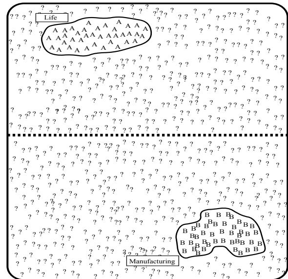
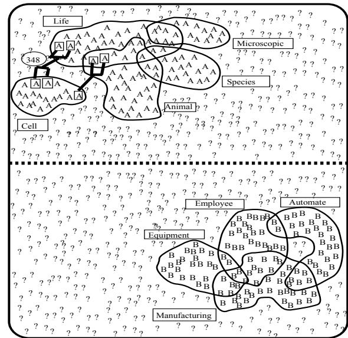
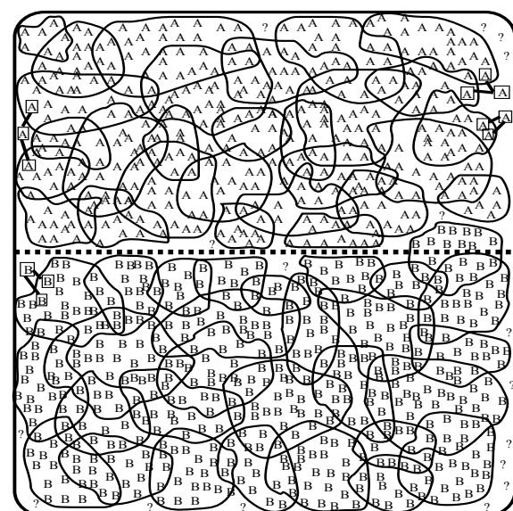

# UNSUPERVISED WORD SENSE DISAMBIGUATIONRIVALING SUPERVISED METHODS

David Yarowsky

Department of Computer and Information ScienceUniversity of PennsylvaniaPhiladelphia, PA 19104, USAyarowsky@unagi.cis.upenn.edu

## Abstract

This paper presents an unsupervised learning algorithm for sense disambiguation that, when trained on unannotated English text, rivals the performance of supervised techniques that require time-consuming hand annotations. The algorithm is based on two powerful constraints – that words tend to have one sense per discourse and one sense per collocation – exploited in an iterative bootstrapping procedure. Tested accuracy exceeds 96%.

## 1 Introduction

This paper presents an unsupervised algorithm that can accurately disambiguate word senses in a large, completely untagged corpus.1 The algorithm avoids the need for costly hand-tagged training data by exploiting two powerful properties of human language:

- 1. **One sense per collocation:**2 Nearby words provide strong and consistent clues to the sense of a target word, conditional on relative distance, order and syntactic relationship.
- 2. **One sense per discourse:** The sense of a target word is highly consistent within any given document.
Moreover, language is highly redundant, so that the sense of a word is effectively overdetermined by (1) and (2) above. The algorithm uses these properties to incrementally identify collocations for target senses of a word, given a few _seed_ collocations

1Note that the problem here is sense _disambiguation_: assigning each instance of a word to established sense definitions (such as in a dictionary). This differs from sense _induction_: using distributional similarity to partition word instances into clusters that may have no relation to standard sense partitions.

2Here I use the traditional dictionary definition of collocation – “appearing in the same location; a juxtaposition of words”. No idiomatic or non-compositional interpretation is implied.

for each sense. This procedure is robust and self-correcting, and exhibits many strengths of supervised approaches, including sensitivity to word-order information lost in earlier unsupervised algorithms.

## 2 One Sense Per Discourse

The observation that words strongly tend to exhibit only one sense in a given discourse or document was stated and quantified in Gale, Church and Yarowsky (1992). Yet to date, the full power of this property has not been exploited for sense disambiguation.

The work reported here is the first to take advantage of this regularity in conjunction with separate models of local context for each word. Importantly, I do not use one-sense-per-discourse as a hard constraint; it affects the classification probabilistically and can be overridden when local evidence is strong.

In this current work, the one-sense-per-discourse hypothesis was tested on a set of 37,232 examples (hand-tagged over a period of 3 years), the same data studied in the disambiguation experiments. For these words, the table below measures the claim’s _accuracy_ (when the word occurs more than once in a discourse, how often it takes on the majority sense for the discourse) and _applicability_ (how often the word _does_ occur more than once in a discourse).

**The one-sense-per-discourse hypothesis:**

<table><tr><th>Word</th><th>Senses</th><th>Accuracy</th><th>Applicblty</th></tr><tr><td>plant</td><td>living/factory</td><td>99.8 %</td><td>72.8 %</td></tr><tr><td>tank</td><td>vehicle/contnr</td><td>99.6 %</td><td>50.5 %</td></tr><tr><td>poach</td><td>steal/boil</td><td>100.0 %</td><td>44.4 %</td></tr><tr><td>palm</td><td>tree/hand</td><td>99.8 %</td><td>38.5 %</td></tr><tr><td>axes</td><td>grid/tools</td><td>100.0 %</td><td>35.5 %</td></tr><tr><td>sake</td><td>benefit/drink</td><td>100.0 %</td><td>33.7 %</td></tr><tr><td>bass</td><td>fish/music</td><td>100.0 %</td><td>58.8 %</td></tr><tr><td>space</td><td>volume/outer</td><td>99.2 %</td><td>67.7 %</td></tr><tr><td>motion</td><td>legal/physical</td><td>99.9 %</td><td>49.8 %</td></tr><tr><td>crane</td><td>bird/machine</td><td>100.0 %</td><td>49.1 %</td></tr><tr><td colspan="2"><strong>Average</strong></td><td><strong>99.8 %</strong></td><td><strong>50.1 %</strong></td></tr></table>

Clearly, the claim holds with very high reliability for these words, and may be confidently exploited

as another source of evidence in sense tagging.3

## 3 One Sense Per Collocation

The strong tendency for words to exhibit only one sense in a given collocation was observed and quantified in (Yarowsky, 1993). This effect varies depending on the type of collocation. It is strongest for immediately adjacent collocations, and weakens with distance. It is much stronger for words in a predicate-argument relationship than for arbitrary associations at equivalent distance. It is very much stronger for collocations with content words than those with function words.4 In general, the high reliability of this behavior (in excess of 97% for adjacent content words, for example) makes it an extremely useful property for sense disambiguation.

A supervised algorithm based on this property is given in (Yarowsky, 1994). Using a decision list control structure based on (Rivest, 1987), this algorithm integrates a wide diversity of potential evidence sources (lemmas, inflected forms, parts of speech and arbitrary word classes) in a wide diversity of positional relationships (including local and distant collocations, trigram sequences, and predicate-argument association). The training procedure computes the word-sense probability distributions for all such collocations, and orders them by the log-likelihood ratio \text{Log}(\frac{\text{Pr}(\text{Sense}_A|\text{Collocation}_i)}{\text{Pr}(\text{Sense}_B|\text{Collocation}_i)}),5 with optional steps for interpolation and pruning. New data are classified by using the single most predictive piece of disambiguating evidence that appears in the target context. By not combining probabilities, this decision-list approach avoids the problematic complex modeling of statistical dependencies

3It is interesting to speculate on the reasons for this phenomenon. Most of the tendency is statistical: two distinct arbitrary terms of moderate corpus frequency are quite unlikely to co-occur in the same discourse whether they are homographs or not. This is particularly true for content words, which exhibit a “bursty” distribution. However, it appears that human writers also have some active tendency to avoid mixing senses within a discourse. In a small study, homograph pairs were observed to co-occur roughly 5 times less often than arbitrary word pairs of comparable frequency. Regardless of origin, this phenomenon is strong enough to be of significant practical use as an additional probabilistic disambiguation constraint.

4This latter effect is actually a continuous function conditional on the _burstiness_ of the word (the tendency of a word to deviate from a constant Poisson distribution in a corpus).

5As most ratios involve a 0 for some observed value, smoothing is crucial. The process employed here is sensitive to variables including the type of collocation (adjacent bigrams or wider context), collocational distance, type of word (content word vs. function word) and the expected amount of noise in the training data. Details are provided in (Yarowsky, to appear).

encountered in other frameworks. The algorithm is especially well suited for utilizing a large set of highly non-independent evidence such as found here. In general, the decision-list algorithm is well suited for the task of sense disambiguation and will be used as a component of the unsupervised algorithm below.

## 4 Unsupervised Learning Algorithm

Words not only tend to occur in collocations that reliably indicate their sense, they tend to occur in multiple such collocations. This provides a mechanism for bootstrapping a sense tagger. If one begins with a small set of seed examples representative of two senses of a word, one can incrementally augment these seed examples with additional examples of each sense, using a combination of the one-sense-per-collocation and one-sense-per-discourse tendencies.

Although several algorithms can accomplish similar ends,6 the following approach has the advantages of simplicity and the ability to build on an existing supervised classification algorithm without modification.7 As shown empirically, it also exhibits considerable effectiveness.

The algorithm will be illustrated by the disambiguation of 7538 instances of the polysemous word _plant_ in a previously untagged corpus.

### STEP 1:

In a large corpus, identify all examples of the given polysemous word, storing their contexts as lines in an initially untagged training set. For example:

<table><tr><th>Sense</th><th>Training Examples (Keyword in Context)</th></tr><tr><td>?</td><td>... company said the <em>plant</em> is still operating</td></tr><tr><td>?</td><td>Although thousands of <em>plant</em> and animal species</td></tr><tr><td>?</td><td>... zonal distribution of <em>plant</em> life . ...</td></tr><tr><td>?</td><td>... to strain microscopic <em>plant</em> life from the ...</td></tr><tr><td>?</td><td>vinyl chloride monomer <em>plant</em> , which is ...</td></tr><tr><td>?</td><td>and Golgi apparatus of <em>plant</em> and animal cells</td></tr><tr><td>?</td><td>... computer disk drive <em>plant</em> located in ...</td></tr><tr><td>?</td><td>... divide life into <em>plant</em> and animal kingdom</td></tr><tr><td>?</td><td>... close-up studies of <em>plant</em> life and natural</td></tr><tr><td>?</td><td>... Nissan car and truck <em>plant</em> in Japan is ...</td></tr><tr><td>?</td><td>... keep a manufacturing <em>plant</em> profitable without</td></tr><tr><td>?</td><td>... molecules found in <em>plant</em> and animal tissue</td></tr><tr><td>?</td><td>... union responses to <em>plant</em> closures . ...</td></tr><tr><td>?</td><td>... animal rather than <em>plant</em> tissues can be</td></tr><tr><td>?</td><td>... many dangers to <em>plant</em> and animal life</td></tr><tr><td>?</td><td>company manufacturing <em>plant</em> is in Orlando ...</td></tr><tr><td>?</td><td>... growth of aquatic <em>plant</em> life in water ...</td></tr><tr><td>?</td><td>automated manufacturing <em>plant</em> in Fremont ,</td></tr><tr><td>?</td><td>... Animal and <em>plant</em> life are delicately</td></tr><tr><td>?</td><td>discovered at a St. Louis <em>plant</em> manufacturing</td></tr><tr><td>?</td><td>computer manufacturing <em>plant</em> and adjacent ...</td></tr><tr><td>?</td><td>... the proliferation of <em>plant</em> and animal life</td></tr><tr><td>?</td><td>... ..</td></tr></table>

6Including variants of the EM algorithm (Baum, 1972; Dempster et al., 1977), especially as applied in Gale, Church and Yarowsky (1994).

7Indeed, any supervised classification algorithm that returns probabilities with its classifications may potentially be used here. These include Bayesian classifiers (Mosteller and Wallace, 1964) and some implementations of neural nets, but not Brill rules (Brill, 1993).

### STEP 2:

For each possible sense of the word, identify a relatively small number of training examples representative of that sense.8 This could be accomplished by hand tagging a subset of the training sentences. However, I avoid this laborious procedure by identifying a small number of seed collocations representative of each sense and then tagging all training examples containing the seed collocates with the seed's sense label. The remainder of the examples (typically 85-98%) constitute an untagged _residual_.

Several strategies for identifying seeds that require minimal or no human participation are discussed in Section 5.

In the example below, the words _life_ and _manufacturing_ are used as seed collocations for the two major senses of plant (labeled A and B respectively). This partitions the training set into 82 examples of living plants (1%), 106 examples of manufacturing plants (1%), and 7350 residual examples (98%).

<table><tr><th>Sense</th><th>Training Examples (Keyword in Context)</th></tr><tr><td>A</td><td>used to strain microscopic <em>plant life</em> from the ...</td></tr><tr><td>A</td><td>... zonal distribution of <em>plant life</em> . ...</td></tr><tr><td>A</td><td>close-up studies of <em>plant life</em> and natural ...</td></tr><tr><td>A</td><td>too rapid growth of aquatic <em>plant life</em> in water ...</td></tr><tr><td>A</td><td>... the proliferation of <em>plant</em> and animal <em>life</em> ...</td></tr><tr><td>A</td><td>establishment phase of the <em>plant</em> virus <em>life</em> cycle ...</td></tr><tr><td>A</td><td>... that divide <em>life</em> into <em>plant</em> and animal kingdom</td></tr><tr><td>A</td><td>... many dangers to <em>plant</em> and animal <em>life</em> ...</td></tr><tr><td>A</td><td>mammals . Animal and <em>plant life</em> are delicately</td></tr><tr><td>A</td><td>beds too salty to support <em>plant life</em> . River ...</td></tr><tr><td>A</td><td>heavy seas, damage , and <em>plant life</em> growing on ...</td></tr><tr><td>A</td><td>... ..</td></tr><tr><td>?</td><td>... vinyl chloride monomer <em>plant</em> , which is ...</td></tr><tr><td>?</td><td>... molecules found in <em>plant</em> and animal tissue</td></tr><tr><td>?</td><td>... Nissan car and truck <em>plant</em> in Japan is ...</td></tr><tr><td>?</td><td>... and Golgi apparatus of <em>plant</em> and animal cells ...</td></tr><tr><td>?</td><td>... union responses to <em>plant</em> closures . ...</td></tr><tr><td>?</td><td>... ..</td></tr><tr><td>?</td><td>... ..</td></tr><tr><td>?</td><td>... cell types found in the <em>plant</em> kingdom are ...</td></tr><tr><td>?</td><td>... company said the <em>plant</em> is still operating ...</td></tr><tr><td>?</td><td>... Although thousands of <em>plant</em> and animal species</td></tr><tr><td>?</td><td>... animal rather than <em>plant</em> tissues can be ...</td></tr><tr><td>?</td><td>... computer disk drive <em>plant</em> located in ...</td></tr><tr><td>B</td><td>... ..</td></tr><tr><td>B</td><td>automated <strong>manufacturing</strong><em>plant</em> in Fremont ...</td></tr><tr><td>B</td><td>... vast <strong>manufacturing</strong><em>plant</em> and distribution ...</td></tr><tr><td>B</td><td>chemical <strong>manufacturing</strong><em>plant</em> , producing viscose</td></tr><tr><td>B</td><td>... keep a <strong>manufacturing</strong><em>plant</em> profitable without</td></tr><tr><td>B</td><td>computer <strong>manufacturing</strong><em>plant</em> and adjacent ...</td></tr><tr><td>B</td><td>discovered at a St. Louis <em>plant</em><strong>manufacturing</strong></td></tr><tr><td>B</td><td>... copper <strong>manufacturing</strong><em>plant</em> found that they</td></tr><tr><td>B</td><td>copper wire <strong>manufacturing</strong><em>plant</em> , for example ...</td></tr><tr><td>B</td><td>'s cement <strong>manufacturing</strong><em>plant</em> in Alpena ...</td></tr><tr><td>B</td><td>polystyrene <strong>manufacturing</strong><em>plant</em> at its Dow ...</td></tr><tr><td>B</td><td>company <strong>manufacturing</strong><em>plant</em> is in Orlando ...</td></tr></table>

It is useful to visualize the process of seed development graphically. The following figure illustrates this sample initial state. Circled regions are the training examples that contain either an A or B seed collocate. The bulk of the sample points "?" constitute the untagged residual.

8For the purposes of exposition, I will assume a binary sense partition. It is straightforward to extend this to k senses using k sets of seeds.

The diagram illustrates a life cycle with two main sections. The top section is labeled "Life" and contains a cluster of 'A' characters. The bottom section is labeled "Manufacturing" and contains a cluster of 'B' characters. The two sections are separated by a dashed line.

The "Life" section contains a cluster of 'A' characters.

Figure 1: Sample Initial State

A = SENSE-A training exampleB = SENSE-B training example? = currently unclassified training example**Life** = Set of training examples containing the collocation "life".

### STEP 3a:

Train the supervised classification algorithm on the SENSE-A/SENSE-B seed sets. The decision-list algorithm used here (Yarowsky, 1994) identifies other collocations that reliably partition the seed training data, ranked by the purity of the distribution. Below is an abbreviated example of the decision list trained on the _plant_ seed data.9

<table><tr><th colspan="3">Initial decision list for <em>plant</em> (abbreviated)</th></tr><tr><th>LogL</th><th>Collocation</th><th>Sense</th></tr><tr><td>8.10</td><td><em>plant life</em></td><td>⇒ A</td></tr><tr><td>7.58</td><td><strong>manufacturing</strong><em>plant</em></td><td>⇒ B</td></tr><tr><td>7.39</td><td><strong>life</strong> (within \pm 2-10 words)</td><td>⇒ A</td></tr><tr><td>7.20</td><td><strong>manufacturing</strong> (in \pm 2-10 words)</td><td>⇒ B</td></tr><tr><td>6.27</td><td>animal (within \pm 2-10 words)</td><td>⇒ A</td></tr><tr><td>4.70</td><td>equipment (within \pm 2-10 words)</td><td>⇒ B</td></tr><tr><td>4.39</td><td>employee (within \pm 2-10 words)</td><td>⇒ B</td></tr><tr><td>4.30</td><td>assembly <em>plant</em></td><td>⇒ B</td></tr><tr><td>4.10</td><td><em>plant</em> closure</td><td>⇒ B</td></tr><tr><td>3.52</td><td><em>plant</em> species</td><td>⇒ A</td></tr><tr><td>3.48</td><td>automate (within \pm 2-10 words)</td><td>⇒ B</td></tr><tr><td>3.45</td><td>microscopic <em>plant</em></td><td>⇒ A</td></tr><tr><td></td><td>...</td><td></td></tr></table>

9Note that a given collocate such as _life_ may appear multiple times in the list in different collocational relationships, including left-adjacent, right-adjacent, co-occurrence at other positions in a \pm k-word window and various other syntactic associations. Different positions often yield substantially different likelihood ratios and in cases such as _pesticide plant_ vs. _plant pesticide_ indicate entirely different classifications.

### STEP 3b:

Apply the resulting classifier to the entire sample set. Take those members in the residual that are tagged as SENSE-A or SENSE-B with probability above a certain threshold, and add those examples to the growing seed sets. Using the decision-list algorithm, these additions will contain newly-learned collocations that are reliably indicative of the previously-trained seed sets. The acquisition of additional partitioning collocations from co-occurrence with previously-identified ones is illustrated in the lower portion of Figure 2.

### STEP 3c:

Optionally, the one-sense-per-discourse constraint is then used both to filter and augment this addition. The details of this process are discussed in Section 7. In brief, if several instances of the polysemous word in a discourse have already been assigned SENSE-A, this sense tag may be extended to all examples in the discourse, conditional on the relative numbers and the probabilities associated with the tagged examples.

**Labeling previously untagged contexts**using the one-sense-per-discourse property

<table><tr><th>Change in tag</th><th>Disc. Numb.</th><th>Training Examples (from same discourse)</th></tr><tr><td>A → A</td><td>724</td><td>... the existence of <em>plant</em> and animal life ...</td></tr><tr><td>A → A</td><td>724</td><td>... classified as either <em>plant</em> or animal ...</td></tr><tr><td>? → A</td><td>724</td><td>Although bacterial and <em>plant</em> cells are enclosed</td></tr><tr><td>A → A</td><td>348</td><td>... the life of the <em>plant</em> , producing stem</td></tr><tr><td>A → A</td><td>348</td><td>... an aspect of <em>plant</em> life , for example</td></tr><tr><td>? → A</td><td>348</td><td>... tissues ; because <em>plant</em> egg cells have</td></tr><tr><td>? → A</td><td>348</td><td>photosynthesis, and so <em>plant</em> growth is attuned</td></tr></table>

This augmentation of the training data can often form a bridge to new collocations that may not otherwise co-occur in the same nearby context with previously identified collocations. Such a bridge to the SENSE-A collocate “cell” is illustrated graphically in the upper half of Figure 2.

Similarly, the one-sense-per-discourse constraint may also be used to correct erroneously labeled examples. For example:

**Error Correction** using the one-sense-per-discourse property

<table><tr><th>Change in tag</th><th>Disc. Numb.</th><th>Training Examples (from same discourse)</th></tr><tr><td>A → A</td><td>525</td><td>contains a varied <em>plant</em> and animal life</td></tr><tr><td>A → A</td><td>525</td><td>the most common <em>plant</em> life , the ...</td></tr><tr><td>A → A</td><td>525</td><td>slight within Arctic <em>plant</em> species ...</td></tr><tr><td>B → A</td><td>525</td><td>are protected by <em>plant</em> parts remaining from</td></tr></table>

### STEP 3d:

Repeat Step 3 iteratively. The training sets (e.g. SENSE-A seeds plus newly added examples) will tend to grow, while the residual will tend to shrink. Additional details aimed at correcting and avoiding misclassifications will be discussed in Section 6.

The diagram is divided into two main sections by a horizontal dashed line. The top section illustrates a taxonomic hierarchy from 'Life' down to 'Cell', with labels for 'Microscopic', 'Species', 'Animal', and '348'. The bottom section shows a hierarchy from 'Equipment' to 'Manufacturing', with labels for 'Employee' and 'Automate'. Both sections are filled with a background of small 'A' and 'B' characters.

**Top Section (Taxonomy):**

**Bottom Section (Manufacturing):**

**Figure 2: Sample Intermediate State**(following Steps 3b and 3c)

### STEP 4:

Stop. When the training parameters are held constant, the algorithm will converge on a stable residual set.

Note that most training examples will exhibit multiple collocations indicative of the same sense (as illustrated in Figure 3). The decision list algorithm resolves any conflicts by using only the single most reliable piece of evidence, _not_ a combination of all matching collocations. This circumvents many of the problems associated with non-independent evidence sources.

The image shows two large, interconnected puzzle areas. The top area is filled with the letter 'A' and question marks, with a small 'A' in a box at the top right. The bottom area is filled with the letter 'B' and question marks, with a small 'B' in a box at the top left. The two areas are separated by a horizontal line with a dashed middle.

The top area is filled with the letter 'A' and question marks. There are several small 'A' boxes scattered throughout.

The bottom area is filled with the letter 'B' and question marks. There are several small 'B' boxes scattered throughout.

**Figure 3: Sample Final State**

### STEP 5:

The classification procedure learned from the final supervised training step may now be applied to new data, and used to annotate the original untagged corpus with sense tags and probabilities.

An abbreviated sample of the final decision list for _plant_ is given below. Note that the original seed words are no longer at the top of the list. They have been displaced by more broadly applicable collocations that better partition the newly learned classes. In cases where there are multiple seeds, it is even possible for an original seed for SENSE-A to become an indicator for SENSE-B if the collocate is more compatible with this second class. Thus the noise introduced by a few irrelevant or misleading seed words is not fatal. It may be corrected if the majority of the seeds forms a coherent collocation space.

<table><tr><th colspan="3">Final decision list for <em>plant</em> (abbreviated)</th></tr><tr><th>LogL</th><th>Collocation</th><th>Sense</th></tr><tr><td>10.12</td><td><em>plant</em> growth</td><td>\Rightarrow A</td></tr><tr><td>9.68</td><td>car (within \pm k words)</td><td>\Rightarrow B</td></tr><tr><td>9.64</td><td><em>plant</em> height</td><td>\Rightarrow A</td></tr><tr><td>9.61</td><td>union (within \pm k words)</td><td>\Rightarrow B</td></tr><tr><td>9.54</td><td>equipment (within \pm k words)</td><td>\Rightarrow B</td></tr><tr><td>9.51</td><td>assembly <em>plant</em></td><td>\Rightarrow B</td></tr><tr><td>9.50</td><td>nuclear <em>plant</em></td><td>\Rightarrow B</td></tr><tr><td>9.31</td><td>flower (within \pm k words)</td><td>\Rightarrow A</td></tr><tr><td>9.24</td><td>job (within \pm k words)</td><td>\Rightarrow B</td></tr><tr><td>9.03</td><td>fruit (within \pm k words)</td><td>\Rightarrow A</td></tr><tr><td>9.02</td><td><em>plant</em> species</td><td>\Rightarrow A</td></tr><tr><td>...</td><td>...</td><td></td></tr></table>

When this decision list is applied to a new test sentence,

... the loss of animal and _plant_ species through extinction ... ,

the highest ranking collocation found in the target context (_species_) is used to classify the example as SENSE-A (a living plant). If available, information from other occurrences of “plant” in the discourse may override this classification, as described in Section 7.

## 5 Options for Training Seeds

The algorithm should begin with seed words that accurately and productively distinguish the possible senses. Such seed words can be selected by any of the following strategies:

### 
- • **Use words in dictionary definitions**

Extract seed words from a dictionary’s entry for the target sense. This can be done automatically, using words that occur with significantly greater frequency in the entry relative to the entire dictionary. Words in the entry appearing in the most reliable collocational relationships with the target word are given the most weight, based on the criteria given in Yarowsky (1993).

### 
- • **Use a single defining collocate for each class**

Remarkably good performance may be achieved by identifying a single defining collocate for each class (e.g. _bird_ and _machine_ for the word crane), and using for seeds only those contexts containing one of these words. WordNet (Miller, 1990) is an automatic source for such defining terms.

### 
- • **Label salient corpus collocates**

Words that co-occur with the target word in unusually great frequency, especially in certain collocational relationships, will tend to be reliable indicators of one of the target word’s senses (e.g. _flock_ and _bulldozer_ for “crane”). A human judge must decide which one, but this can be done very quickly (typically under 2 minutes for a full list of 30-60 such words). Co-occurrence analysis selects collocates that span the space with minimal overlap, optimizing the efforts of the human assistant. While not fully automatic, this approach yields rich and highly reliable seed sets with minimal work.

## 6 Escaping from Initial Misclassifications

Unlike many previous bootstrapping approaches, the present algorithm can escape from initial misclassification. Examples added to the the growing seed sets remain there only as long as the probability of the classification stays above the threshold. If their classification begins to waver because new examples have discredited the crucial collocate, they are returned to the residual and may later be classified differently. Thus contexts that are added to the wrong seed set because of a misleading word in a dictionary definition may be (and typically are) correctly reclassified as iterative training proceeds. The redundancy of language with respect to collocation makes the process primarily self-correcting. However, certain strong collocates may become entrenched as indicators for the wrong class. We discourage such behavior in the training algorithm by two techniques: 1) incrementally increasing the width of the context window after intermediate convergence (which periodically adds new feature values to shake up the system) and 2) randomly perturbing the class-inclusion threshold, similar to simulated annealing.

## 7 Using the One-sense-per-discourse Property

The algorithm performs well using only local collocational information, treating each token of the target word independently. However, accuracy can be improved by also exploiting the fact that all occurrences of a word in the discourse are likely to exhibit the same sense. This property may be utilized in two places, either once at the end of Step

<table><tr><th>(1)</th><th>(2)</th><th>(3)</th><th>(4)</th><th>(5)</th><th>(6)</th><th>(7)</th><th>(8)</th><th>(9)</th><th>(10)</th><th>(11)</th></tr><tr><th rowspan="2">Word</th><th rowspan="2">Senses</th><th rowspan="2">Samp. Size</th><th rowspan="2">% Major Sense</th><th rowspan="2">Supvsd Algrtm</th><th colspan="3">Seed Training Options</th><th colspan="2">(7) + OSPD</th><th rowspan="2">Schütze Algrthm</th></tr><tr><th>Two Words</th><th>Dict. Defn.</th><th>Top Colls.</th><th>End only</th><th>Each Iter.</th></tr><tr><td>plant</td><td>living/factory</td><td>7538</td><td>53.1</td><td>97.7</td><td>97.1</td><td>97.3</td><td>97.6</td><td>98.3</td><td>98.6</td><td>92</td></tr><tr><td>space</td><td>volume/outer</td><td>5745</td><td>50.7</td><td>93.9</td><td>89.1</td><td>92.3</td><td>93.5</td><td>93.3</td><td>93.6</td><td>90</td></tr><tr><td>tank</td><td>vehicle/container</td><td>11420</td><td>58.2</td><td>97.1</td><td>94.2</td><td>94.6</td><td>95.8</td><td>96.1</td><td>96.5</td><td>95</td></tr><tr><td>motion</td><td>legal/physical</td><td>11968</td><td>57.5</td><td>98.0</td><td>93.5</td><td>97.4</td><td>97.4</td><td>97.8</td><td>97.9</td><td>92</td></tr><tr><td>bass</td><td>fish/music</td><td>1859</td><td>56.1</td><td>97.8</td><td>96.6</td><td>97.2</td><td>97.7</td><td>98.5</td><td>98.8</td><td>–</td></tr><tr><td>palm</td><td>tree/hand</td><td>1572</td><td>74.9</td><td>96.5</td><td>93.9</td><td>94.7</td><td>95.8</td><td>95.5</td><td>95.9</td><td>–</td></tr><tr><td>poach</td><td>steal/boil</td><td>585</td><td>84.6</td><td>97.1</td><td>96.6</td><td>97.2</td><td>97.7</td><td>98.4</td><td>98.5</td><td>–</td></tr><tr><td>axes</td><td>grid/tools</td><td>1344</td><td>71.8</td><td>95.5</td><td>94.0</td><td>94.3</td><td>94.7</td><td>96.8</td><td>97.0</td><td>–</td></tr><tr><td>duty</td><td>tax/obligation</td><td>1280</td><td>50.0</td><td>93.7</td><td>90.4</td><td>92.1</td><td>93.2</td><td>93.9</td><td>94.1</td><td>–</td></tr><tr><td>drug</td><td>medicine/narcotic</td><td>1380</td><td>50.0</td><td>93.0</td><td>90.4</td><td>91.4</td><td>92.6</td><td>93.3</td><td>93.9</td><td>–</td></tr><tr><td>sake</td><td>benefit/drink</td><td>407</td><td>82.8</td><td>96.3</td><td>59.6</td><td>95.8</td><td>96.1</td><td>96.1</td><td>97.5</td><td>–</td></tr><tr><td>crane</td><td>bird/machine</td><td>2145</td><td>78.0</td><td>96.6</td><td>92.3</td><td>93.6</td><td>94.2</td><td>95.4</td><td>95.5</td><td>–</td></tr><tr><td>AVG</td><td></td><td>3936</td><td>63.9</td><td>96.1</td><td>90.6</td><td>94.8</td><td>95.5</td><td>96.1</td><td>96.5</td><td>92.2</td></tr></table>

4 after the algorithm has converged, or in Step 3c after each iteration.

At the end of Step 4, this property is used for error correction. When a polysemous word such as _plant_ occurs multiple times in a discourse, tokens that were tagged by the algorithm with low confidence using local collocation information may be overridden by the dominant tag for the discourse. The probability differentials necessary for such a re-classification were determined empirically in an early pilot study. The variables in this decision are the total number of occurrences of _plant_ in the discourse (n), the number of occurrences assigned to the majority and minor senses for the discourse, and the cumulative scores for both (a sum of log-likelihood ratios). If cumulative evidence for the majority sense exceeds that of the minority by a threshold (conditional on n), the minority cases are relabeled. The case n = 2 does not admit much reclassification because it is unclear which sense is dominant. But for n \geq 4, all but the most confident local classifications tend to be overridden by the dominant tag, because of the overwhelming strength of the one-sense-per-discourse tendency.

The use of this property after each iteration is similar to the final post-hoc application, but helps prevent initially mistagged collocates from gaining a foothold. The major difference is that in discourses where there is substantial disagreement concerning which is the dominant sense, _all_ instances in the discourse are returned to the residual rather than merely leaving their current tags unchanged. This helps improve the purity of the training data.

The fundamental limitation of this property is coverage. As noted in Section 2, half of the examples occur in a discourse where there are no other instances of the same word to provide corroborating evidence for a sense or to protect against misclassification. There is additional hope for these cases,

however, as such isolated tokens tend to strongly favor a particular sense (the less “bursty” one). We have yet to use this additional information.

## 8 Evaluation

The words used in this evaluation were randomly selected from those previously studied in the literature. They include words where sense differences are realized as differences in French translation (drug → drogue/médicament, and duty → devoir/droit), a verb (poach) and words used in Schütze’s 1992 disambiguation experiments (tank, space, motion, plant).10

The data were extracted from a 460 million word corpus containing news articles, scientific abstracts, spoken transcripts, and novels, and almost certainly constitute the largest training/testing sets used in the sense-disambiguation literature.

Columns 6-8 illustrate differences in seed training options. Using only two words as seeds does surprisingly well (90.6 %). This approach is least successful for senses with a complex concept space, which cannot be adequately represented by single words. Using the salient words of a dictionary definition as seeds increases the coverage of the concept space, improving accuracy (94.8%). However, spurious words in example sentences can be a source of noise. Quick hand tagging of a list of algorithmically-identified salient collocates appears to be worth the effort, due to the increased accuracy (95.5%) and minimal cost.

Columns 9 and 10 illustrate the effect of adding the probabilistic one-sense-per-discourse constraint to collocation-based models using dictionary entries as training seeds. Column 9 shows its effectiveness

10The number of words studied has been limited here by the highly time-consuming constraint that full hand tagging is necessary for direct comparison with supervised training.

as a post-hoc constraint. Although apparently small in absolute terms, on average this represents a 27% reduction in error rate. When applied at each iteration, this process reduces the training noise, yielding the optimal observed accuracy in column 10.

### Comparative performance:

Column 5 shows the relative performance of supervised training using the decision list algorithm, applied to the same data and not using any discourse information. Unsupervised training using the additional one-sense-per-discourse constraint frequently exceeds this value. Column 11 shows the performance of Schütze’s unsupervised algorithm applied to some of these words, trained on a New York Times News Service corpus. Our algorithm exceeds this accuracy on each word, with an average relative performance of 97% vs. 92%.11

## 9 Comparison with Previous Work

This algorithm exhibits a fundamental advantage over supervised learning algorithms (including Black (1988), Hearst (1991), Gale et al. (1992), Yarowsky (1993, 1994), Leacock et al. (1993), Bruce and Wiebe (1994), and Lehman (1994)), as it does not require costly hand-tagged training sets. It thrives on raw, unannotated monolingual corpora – the more the merrier. Although there is some hope from using aligned bilingual corpora as training data for supervised algorithms (Brown et al., 1991), this approach suffers from both the limited availability of such corpora, and the frequent failure of bilingual translation differences to model monolingual sense differences.

The use of dictionary definitions as an optional seed for the unsupervised algorithm stems from a long history of dictionary-based approaches, including Lesk (1986), Guthrie et al. (1991), Veronis and Ide (1990), and Slator (1991). Although these earlier approaches have used often sophisticated measures of overlap with dictionary definitions, they have not realized the potential for combining the relatively limited seed information in such definitions with the nearly unlimited co-occurrence information extractable from text corpora.

Other unsupervised methods have shown great promise. Dagan and Itai (1994) have proposed a method using co-occurrence statistics in independent monolingual corpora of two languages to guide lexical choice in machine translation. Translation of a Hebrew verb-object pair such as _lahtom_ (sign or seal) and _hoze_ (contract or treaty) is determined using the most probable combination of words in an English monolingual corpus. This work shows that leveraging bilingual lexicons and monolingual

language models can overcome the need for aligned bilingual corpora.

Hearst (1991) proposed an early application of bootstrapping to augment training sets for a supervised sense tagger. She trained her fully supervised algorithm on hand-labelled sentences, applied the result to new data and added the most confidently tagged examples to the training set. Regrettably, this algorithm was only described in two sentences and was not developed further. Our current work differs by eliminating the need for hand-labelled training data entirely and by the joint use of collocation and discourse constraints to accomplish this.

Schütze (1992) has pioneered work in the hierarchical clustering of word senses. In his disambiguation experiments, Schütze used post-hoc alignment of clusters to word senses. Because the top-level cluster partitions based purely on distributional information do not necessarily align with standard sense distinctions, he generated up to 10 sense clusters and manually assigned each to a fixed sense label (based on the hand-inspection of 10-20 sentences per cluster). In contrast, our algorithm uses automatically acquired seeds to tie the sense partitions to the desired standard at the _beginning_, where it can be most useful as an anchor and guide.

In addition, Schütze performs his classifications by treating documents as a large unordered bag of words. By doing so he loses many important distinctions, such as collocational distance, word sequence and the existence of predicate-argument relationships between words. In contrast, our algorithm models these properties carefully, adding considerable discriminating power lost in other relatively impoverished models of language.

## 10 Conclusion

In essence, our algorithm works by harnessing several powerful, empirically-observed properties of language, namely the strong tendency for words to exhibit only one sense per collocation and per discourse. It attempts to derive maximal leverage from these properties by modeling a rich diversity of collocational relationships. It thus uses more discriminating information than available to algorithms treating documents as bags of words, ignoring relative position and sequence. Indeed, one of the strengths of this work is that it is sensitive to a wider range of language detail than typically captured in statistical sense-disambiguation algorithms.

Also, for an unsupervised algorithm it works surprisingly well, directly outperforming Schütze’s unsupervised algorithm 96.7 % to 92.2 %, on a test of the same 4 words. More impressively, it achieves nearly the same performance as the supervised algorithm given identical training contexts (95.5 % vs. 96.1 %), and in some cases actually achieves

11This difference is even more striking given that Schütze’s data exhibit a higher baseline probability (65% vs. 55%) for these words, and hence constitute an easier task.

superior performance when using the one-sense-per-discourse constraint (96.5 % vs. 96.1%). This would indicate that the cost of a large sense-tagged training corpus may not be necessary to achieve accurate word-sense disambiguation.

## Acknowledgements

This work was partially supported by an NDSEG Fellowship, ARPA grant N00014-90-J-1863 and ARO grant DAAL 03-89-C0031 PRI. The author is also affiliated with the Information Principles Research Center AT&T Bell Laboratories, and greatly appreciates the use of its resources in support of this work. He would like to thank Jason Eisner, Mitch Marcus, Mark Liberman, Alison Mackey, Dan Melamed and Lyle Ungar for their valuable comments.

## References

- Baum, L.E., "An Inequality and Associated Maximization Technique in Statistical Estimation of Probabilistic Functions of a Markov Process," _Inequalities_, v 3, pp 1-8, 1972.
- Black, Ezra, "An Experiment in Computational Discrimination of English Word Senses," in _IBM Journal of Research and Development_, v 232, pp 185-194, 1988.
- Brill, Eric, "A Corpus-Based Approach to Language Learning," Ph.D. Thesis, University of Pennsylvania, 1993.
- Brown, Peter, Stephen Della Pietra, Vincent Della Pietra, and Robert Mercer, "Word Sense Disambiguation using Statistical Methods," _Proceedings of the 29th Annual Meeting of the Association for Computational Linguistics_, pp 264-270, 1991.
- Bruce, Rebecca and Janyce Wiebe, "Word-Sense Disambiguation Using Decomposable Models," in _Proceedings of the 32nd Annual Meeting of the Association for Computational Linguistics_, Las Cruces, NM, 1994.
- Church, K.W., "A Stochastic Parts Program an Noun Phrase Parser for Unrestricted Text," in _Proceeding, IEEE International Conference on Acoustics, Speech and Signal Processing_, Glasgow, 1989.
- Dagan, Ido and Alon Itai, "Word Sense Disambiguation Using a Second Language Monolingual Corpus", _Computational Linguistics_, v 20, pp 563-596, 1994.
- Dempster, A.P., Laird, N.M, and Rubin, D.B., "Maximum Likelihood From Incomplete Data via the EM Algorithm," _Journal of the Royal Statistical Society_, v 39, pp 1-38, 1977.
- Gale, W., K. Church, and D. Yarowsky, "A Method for Disambiguating Word Senses in a Large Corpus," _Computers and the Humanities_, 26, pp 415-439, 1992.
- Gale, W., K. Church, and D. Yarowsky. "Discrimination Decisions for 100,000-Dimensional Spaces." In A. Zampoli, N. Calzolari and M. Palmer (eds.), _Current Issues in Computational Linguistics: In Honour of Don Walker_, Kluwer Academic Publishers, pp. 429-450, 1994.
- Guthrie, J., L. Guthrie, Y. Wilks and H. Aidinejad, "Subject Dependent Co-occurrence and Word Sense Disambiguation," in _Proceedings of the 29th Annual Meeting of the Association for Computational Linguistics_, pp 146-152, 1991.
- Hearst, Marti, "Noun Homograph Disambiguation Using Local Context in Large Text Corpora," in _Using Corpora_, University of Waterloo, Waterloo, Ontario, 1991.
- Leacock, Claudia, Geoffrey Towell and Ellen Voorhees "Corpus-Based Statistical Sense Resolution," in _Proceedings, ARPA Human Language Technology Workshop_, 1993.
- Lehman, Jill Fain, "Toward the Essential Nature of Statistical Knowledge in Sense Resolution", in _Proceedings of the Twelfth National Conference on Artificial Intelligence_, pp 734-471, 1994.
- Lesk, Michael, "Automatic Sense Disambiguation: How to tell a Pine Cone from an Ice Cream Cone," _Proceeding of the 1986 SIGDOC Conference_, Association for Computing Machinery, New York, 1986.
- Miller, George, "WordNet: An On-Line Lexical Database," _International Journal of Lexicography_, 3, 4, 1990.
- Mosteller, Frederick, and David Wallace, _Inference and Disputed Authorship: The Federalist_, Addison-Wesley, Reading, Massachusetts, 1964.
- Rivest, R. L., "Learning Decision Lists," in _Machine Learning_, 2, pp 229-246, 1987.
- Schütze, Hinrich, "Dimensions of Meaning," in _Proceedings of Supercomputing '92_, 1992.
- Slator, Brian, "Using Context for Sense Preference," in _Text-Based Intelligent Systems: Current Research in Text Analysis, Information Extraction and Retrieval_, P.S. Jacobs, ed., GE Research and Development Center, Schenectady, New York, 1990.
- Veronis, Jean and Nancy Ide, "Word Sense Disambiguation with Very Large Neural Networks Extracted from Machine Readable Dictionaries," in _Proceedings, COLING-90_, pp 389-394, 1990.
- Yarowsky, David "Word-Sense Disambiguation Using Statistical Models of Roget's Categories Trained on Large Corpora," in _Proceedings, COLING-92_, Nantes, France, 1992.
- Yarowsky, David, "One Sense Per Collocation," in _Proceedings, ARPA Human Language Technology Workshop_, Princeton, 1993.
- Yarowsky, David, "Decision Lists for Lexical Ambiguity Resolution: Application to Accent Restoration in Spanish and French," in _Proceedings of the 32nd Annual Meeting of the Association for Computational Linguistics_, Las Cruces, NM, 1994.
- Yarowsky, David. "Homograph Disambiguation in Speech Synthesis." In J. Hirschberg, R. Sproat and J. van Santen (eds.), _Progress in Speech Synthesis_, Springer-Verlag, to appear.